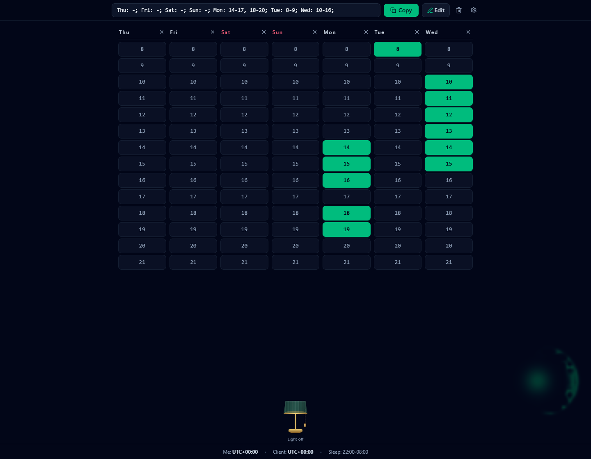
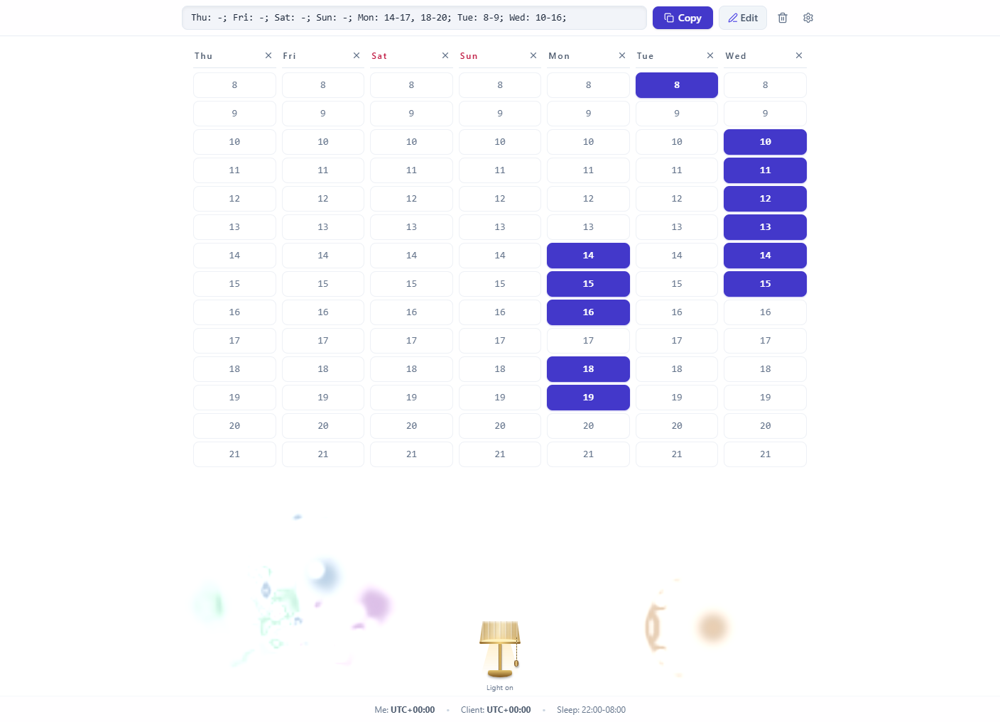

# TimeSlotter

TimeSlotter is a browser-based availability planner. Select weekly hours, optionally convert them between your and your client's UTC offsets, then copy a compact schedule to share.

## Preview

<div align="center">
  
  
</div>

## Features

- **Weekly schedule:** Select hours by clicking, dragging, or touch. Change the starting day, clear individual days, or clear the whole week.
- **Sleep hours:** Hide a configurable sleep window from the grid, or show all 24 hours.
- **Timezone conversion:** Set your UTC offset and your client's UTC offset to convert the generated availability.
- **Readable output:** Copy a single-line, 24-hour schedule with consecutive hours grouped into ranges. Empty days are shown as `-`.
- **Theme options:** Choose light or dark mode in Settings, or use the pull-chain lamp below the schedule. Dark mode is the default.
- **Optional persistence:** Settings are saved in the browser. Weekly selections reset on reload unless schedule persistence is enabled.
- **Manual editing:** Open a non-shifting schedule editor over the grid. The copyable client-timezone result stays visible while text and grid changes stay synchronized.
- **Touch selection:** Drag across a day's slots to select a range. With all 24 hours visible, the grid stays in normal page flow and may extend below the screen; scroll the page before or after selecting. A vertical page scroll can cancel an in-progress touch drag.

## Local development

```bash
npm ci
npm run dev
```

Run the production build and tests with:

```bash
npm run build
npm test
```

## GitHub Pages

The workflow in `.github/workflows/deploy.yml` builds and deploys the app when changes are pushed to `main` or `master`. If Pages is not enabled automatically, open **Settings → Pages** and select **GitHub Actions** as the deployment source.
